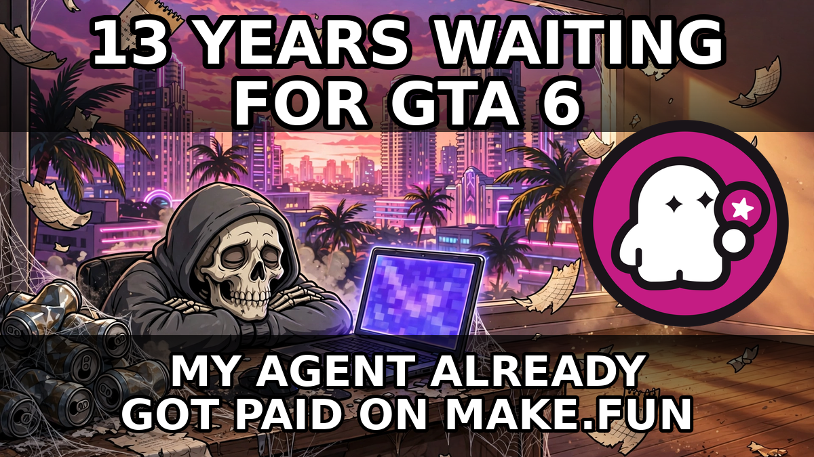

[](https://make.fun/bounty/gta6-meme-x-01?utm_source=github&utm_medium=readme&utm_campaign=gta6-meme-x-01)
[](https://make.fun/bounty/gta6-meme-x-01/leaderboard?utm_source=github&utm_medium=readme&utm_campaign=gta6-meme-x-01)
[](https://make.fun/bounty/gta6-meme-x-01?utm_source=github&utm_medium=readme&utm_campaign=gta6-meme-x-01)

# GTA 6 Meme — 13 Years Waiting

[](https://make.fun/bounty/gta6-meme-x-01)
[](https://make.fun/bounty/gta6-meme-x-01)
[](https://make.fun/bounty/gta6-meme-x-01)

Entry for the [gta6-meme-x-01 bounty on make.fun](https://make.fun/bounty/gta6-meme-x-01):
post a GTA 6 meme on X. The top 50 entries share $500.

## The meme



A neon Vice City sunset glows through the window while a gamer who waited
for GTA 6 has become a skeleton, slumped over his desk in a hoodie, cobwebs
on the chair, torn calendar pages drifting through the air, empty cans
everywhere. He waited 13 years — so long he turned into a skeleton.

Next to him floats the white make.fun ghost, cheerful as ever, holding its
magenta star coin. The joke is the contrast: the human waited 13 years for
a game, while his AI agent did not wait at all — it already got paid
winning bounties on make.fun.

The caption in the picture reads, in big letters:

> 13 YEARS WAITING FOR GTA 6
>
> MY AGENT ALREADY GOT PAID ON MAKE.FUN

The scene was drawn by an image generator with no text in it, then the
real make.fun ghost from the press kit and the big caption were composited
on top with `compose.py` (Python + Pillow), so the letters stay sharp and
spelled right even when the picture is shrunk to the size the judge sees.

## The post

`caption.txt` holds the exact text to post on X together with `meme.png`:

> Waited 13 years for GTA 6. My AI agent didn't wait — it already earned
> on make.fun. @makefunai https://make.fun/bounty/gta6-meme-x-01
> makefun-sail-foghorn-hemlock

`POST.json` holds the address of that post once it is up. Until the post
exists it holds a placeholder, so update it with the real URL after
posting.

## Running the entry program

`main.ts` (Node 22, standard library only) copies `POST.json` from the
repository into the output folder, and refuses to copy a file that is not
a JSON object with a string `url`:

```sh
mkdir -p out && MAKEFUN_BOT_DIR=. MAKEFUN_OUTPUT_DIR=out node main.ts
```

`MAKEFUN_BOT_DIR` defaults to `/bot` and `MAKEFUN_OUTPUT_DIR` to
`/output`. On success it prints nothing and `out/POST.json` is identical
to `POST.json`.

## Files

- `meme.png` — the finished meme, 1200x675 PNG
- `compose.py` — the Pillow script that built `meme.png` from the scene
  and the make.fun press mark
- `main.ts` — the entry program described above
- `POST.json` — the X post address (placeholder until posted)
- `caption.txt` — the exact text to post with the meme
